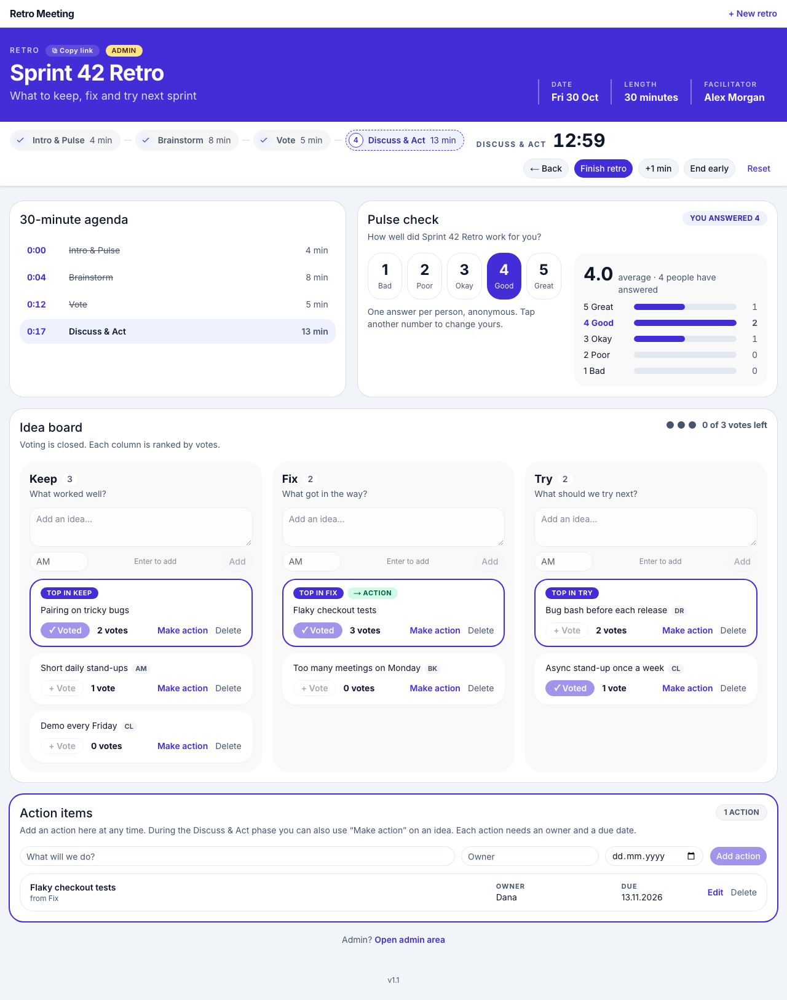

# Retro Meeting

Real-time team retrospectives (Keep / Fix / Try). Participants join via link, no sign-up.

**Live:** https://retro-meeting.andreasknoor.com · **Plan:** [IMPLEMENTATION_PLAN.md](IMPLEMENTATION_PLAN.md) · **Prototype:** [mockups/prototype.html](mockups/prototype.html)



## Features

- Create a retro (name, goal, date, length, facilitator, phases, admin password); share it by link
- Phases with a synchronized timer: Intro & Pulse → Brainstorm → Vote → Discuss & Act (Back, +1 min, End early, Reset)
- By default only the admin switches phases; the creator is logged in automatically
- Anonymous pulse check (1–5), live idea board, one vote per column, action items with owner and optional due date
- Admin area per retro: agenda times, phase control, delete any idea, delete the retro

## Stack

Next.js 16 (App Router, TypeScript, Tailwind, shadcn/ui) · Convex (database, realtime, server functions) · Vercel (Hobby) · GitHub Actions

## Local development

Prerequisites: Node 24+, a Convex login with access to the project (`npx convex login --vercel`).

```bash
npm install
npx convex dev        # terminal 1: pushes convex/ to your dev deployment, writes .env.local
npm run dev           # terminal 2: http://localhost:3000
```

If `npx`-spawned installs fail with `EALLOWSCRIPTS`, your user `.npmrc` sets `allow-scripts`; run the command with `NPM_CONFIG_USERCONFIG=/dev/null`.

## Tests

| Command | What |
|---|---|
| `npm test` | Unit, component and Convex backend tests (Vitest, convex-test) |
| `npm run test:coverage` | Same with coverage; fails below the gates (convex/ ≥ 90 %, lib/ ≥ 80 %) |
| `npm run test:e2e` | Playwright on desktop + mobile against a local production build (port 3100) and the Convex dev deployment |
| `npm run loadtest` | One complete retro with 30 simulated participants against the **dev** deployment |

E2E tests delete every retro they create. CI runs lint, typecheck and coverage on every push; after each production deployment the E2E suite runs against https://retro-meeting.andreasknoor.com.

## Releases

Never `git push` directly — every push is a release:

```bash
npm run release              # 0.13 → 0.14, commit, tag v0.14, push
npm run release -- --major   # only on the owner's explicit instruction
```

A pre-push hook blocks pushes whose HEAD is not tagged with the current version. Vercel deploys `main` automatically; the build runs `npx convex deploy` before `next build`.

## Environment variables

| Variable | Where | Purpose |
|---|---|---|
| `CONVEX_DEPLOY_KEY` | Vercel (Production, Preview) | Lets the build deploy the Convex backend (set by the Marketplace integration) |
| `NEXT_PUBLIC_CONVEX_URL` | Vercel / `.env.local` | Convex deployment URL for the browser and server actions |
| `CONVEX_DEPLOYMENT` | `.env.local` | Your dev deployment (written by `npx convex dev`) |

## Security notes

- Admin passwords are stored as salted scrypt hashes; 5 failed logins lock the retro's admin login for 15 minutes.
- The admin session token lives only in an HTTP-only, SameSite=strict cookie; all admin operations run through server actions.
- Participants are pseudonymous browser IDs; nothing returned to clients reveals who wrote, voted or answered what.
- Rate limits (`convex/lib/rateLimits.ts`): 60 new retros per hour overall, 60 writes per minute per browser.
- Security headers (CSP, no framing, `nosniff`) are set in `next.config.ts`.
- Known limit of the no-login design: a script can invent many participant IDs and so cast extra votes or flood a retro. The retro link is the only access control, so share it only with the team.
